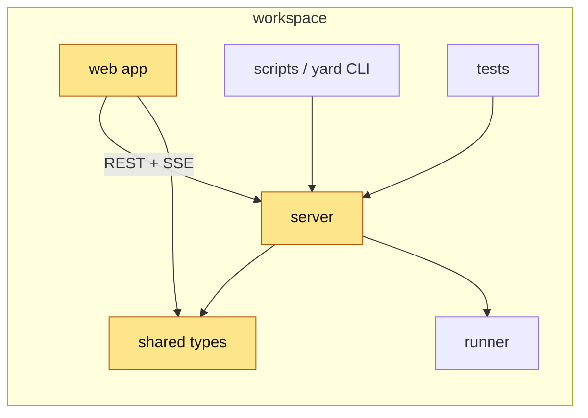

<!-- 10 · Area map — the change spans the workspace. Organise by where it lives; the diagram is
     the Box Yard areas with touched areas lit up. -->

<Two sentences: what landed across the workspace, and the one place a reviewer should start.>

**Contents:** [📦 By area](#user-content-by-area) · [🧩 Workspace map](#user-content-workspace-map) · [📸 Screenshots](#user-content-screenshots) · [⚠️ Risk](#user-content-risk) · [🔧 Technical overview](#user-content-technical-overview) · [📝 Notes](#user-content-notes)

## 📦 By area 

### 🧱 shared

- **<Hook>.** <The type, flag or protocol field, and what it means for the user, one sentence.>

### ⚙ server

- **<Hook>.** <What the server now does, the hook route or mechanism in backticks.>
- **<Hook>.** <…>

### 🖥 web app

- **<Hook>.** <What the user sees, the key in backticks, the panel it lives in.>

### 💻 Box Yard CLI/scripts

- **<Hook>.** <The subcommand or flag, `./yard `, and what it prints.>

### 📚 docs

- **<Hook>.** <Which of the DOCS PAGES changed.>

## 🧩 Workspace map 

<!-- Give the `changed` class to every area the diffstat names; leave the rest plain. -->

## 📸 Screenshots 

| <Caption: what the web app shows after the change> |
|---|
|  |

<!-- A pure server/core change: a fenced block of the terminal output instead, plus one line on why there is no PNG. -->

## ⚠️ Risk 

<!-- Only when the change ADDS A SURFACE — the server execs a program, opens a socket, route or
     HTTP request, reads a new config source, writes a file it did not before. One bullet per way
     in: who or what reaches it, what holds it, what does not. The 🔒 row below then rates the
     residue. A PR that adds no surface deletes this subsection. -->
### 🎯 Attack surface 

- **<Way in>.** <Who or what reaches it. Held by: <mitigation>. Not held: <what remains>.>
- **<Way in>.** <…>

**Verdict:** <🟢 Low risk · 🟡 Merge with care · 🔴 Do not merge as-is — pick one, then one clause saying why. The author's own read; the PR REVIEWER SKILL checks it against the diff.>

| | Level | Why |
|---|---|---|
| 🔒 **Security & production** | <Low / Medium / High> | <who can reach the new code and what it reaches — a new `HTTP request`, a hook route, a shell call, a token, a file the server writes — or "no new surface: <why>"> |
| ⚡ **Performance** | <Low / Medium / High> | <the hot path touched — the web app draw, the event-loop drain, the worker log path, the scheduler/maintenance tick — or "off every hot path: <why>"> |
| 🧩 **Fit with the codebase** | <Low / Medium / High> | <the existing pattern it follows, or the departure and why> |

**Rollback:** <one line — `git revert <merge>`, plus what the revert does not undo: a schema/config change, a migrated SQLite store, a pushed branch.>

## 🔧 Technical overview 

- **shared.** `shared/<file>.ts` — <clause>. <schema/config change, or "unchanged".>
- **server.** `server/<file>.ts` — <clause>; `server/<other>.ts` — <clause>.
- **web app.** `web/src/<file>.tsx` — <clause>.
- **runner/scripts.** `runner/<file>.mjs` or `scripts/<file>.ts` — <clause>.
- **Not done.** <The approach rejected and why.>
- **Gate.** <`npm test` and `npm run typecheck` green; or what did not run and why.>

## 📝 Notes 

- <Merge state, conflicts.>
- <Upgrade note: `restart Box Yard` first when the schema/config change requires it.>

🤖 Generated with [Claude Code](https://claude.com/claude-code)

<optional session link; delete this line when none is provided>
